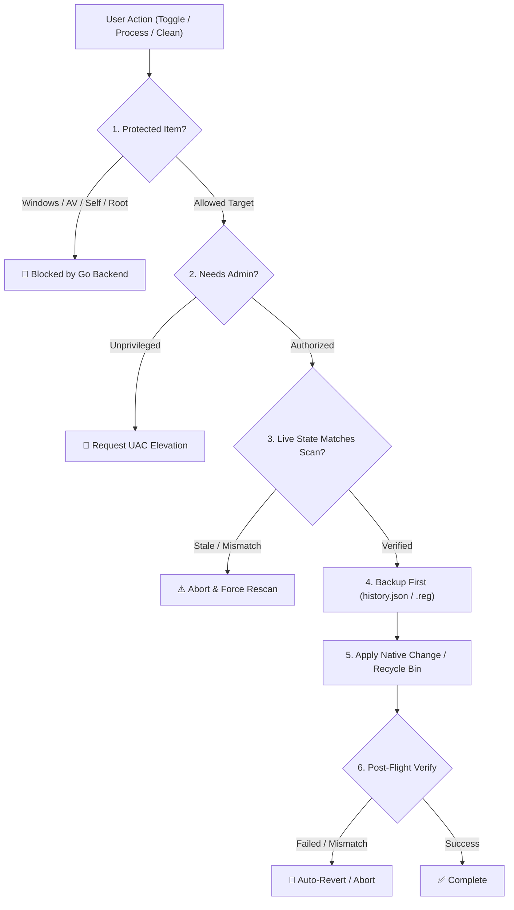

<div align="center">

#  WinBGM

**Windows Background Manager**  
*The safe, modern background application, process & persistence manager for Windows 10 and 11.*

[](https://go.dev/)
[](https://wails.io/)
[](https://microsoft.com/windows)
[]()
[]()
[](https://virustotal.com)
[](LICENSE)

<br/>

[Why WinBGM?](#-why-winbgm) •
[Safety & What It Touches](#-safety--what-winbgm-touches) •
[Key Capabilities](#-key-capabilities) •
[Persistence Vectors](#-12-persistence-locations) •
[Download & Build](#-quick-start)

</div>

---

## ⚡ Why WinBGM?

- **Windows Task Manager** only exposes basic startup folders and active processes, hiding deep persistence vectors.
- **Sysinternals Autoruns** lists raw registry entries with zero guardrails or undo history—one wrong click can break boot.
- **WinBGM** brings **startup management, live process & network control, boot profiling, a persistence watchdog, file-lock inspection, and leftover cleanup** together in one portable Fluent UI with Go-enforced safety guardrails.

### Feature Comparison

| Capability | Task Manager | Sysinternals Autoruns | WinBGM |
| :--- | :---: | :---: | :---: |
| **Deep Persistence** | ⚠️ Basic Run keys only | ⚠️ 100+ raw entries (ungrouped) | **✅ 12 Vectors Grouped by App** |
| **Safe Startup Toggling** | ⚠️ Partial | ❌ Deletes / renames registry keys | **✅ Native `StartupApproved` & `Manual` Service** |
| **Audit Trail & Rollback** | ❌ None | ❌ None | **✅ Pre-flight `history.json` & Undo** |
| **OS / Antivirus Guardrails** | ❌ None | ❌ None | **✅ Go-Enforced System, AV & Self Locks** |
| **Live Process & EcoQoS** | ✅ Basic Efficiency Mode | ❌ None | **✅ Grouped CPU%, RAM, Disk I/O, EcoQoS, Freeze** |
| **Network & Telemetry Monitor** | ❌ None | ❌ None | **✅ Live `iphlpapi.dll` Sockets & Telemetry Tags** |
| **Boot Event Profiler** | Basic "Impact" label | ❌ None | **✅ Event IDs 100–109 Breakdown** |
| **Sleep Blocker Detection** | ❌ None | ❌ None | **✅ Direct `powercfg /requests` Telemetry** |
| **File Lock Finder** | ❌ None | ❌ None | **✅ Native `rstrtmgr.dll` Lock Inspector** |
| **VirusTotal Integration** | ❌ None | ✅ Hashes only | **✅ 1-Click SHA-256 Lookup** |
| **Uninstaller & Cache Clean** | ⚠️ Leaves GBs behind | ❌ None | **✅ Recycle-Bin Safe + `.reg` Backups** |
| **Modern Fluent UI** | Standard OS | Legacy Win32 | **✅ Dark / Light / AMOLED / System + Accents** |

---

## 🛡️ Safety & What WinBGM Touches

All safety checks are enforced in compiled Go backend code—the frontend UI is never trusted.

### What It Touches vs. Never Touches
- **Never Touches**: Windows OS components (`\Windows\`), critical system services (`WinDefend`, `RpcSs`, `DcomLaunch`, `CryptSvc`, etc.), registered antivirus/security software, critical kernel/idle processes (`csrss.exe`, `lsass.exe`, `services.exe`, `svchost.exe`, `dwm.exe`), shared vendor roots (`AppData\Microsoft`, `Software\Google`), or WinBGM itself.
- **Startup / Services / Tasks**: Never deleted when toggled. Startup items use Windows' `StartupApproved` bitmask, services move to `Manual` (never `Disabled`), and tasks are toggled natively. Every change is written to `%APPDATA%\WinBGM\history.json` **before** applying, read back live, and auto-reverted if verification fails.
- **Uninstaller Leftover Cleanup**: Nothing is ever pre-selected. Every path is validated against an allowlist in Go, leftover files are moved to the **Windows Recycle Bin** via `SHFileOperationW` (refusing permanent fallback deletion if the Recycle Bin fails), and registry keys are exported to `.reg` backups in `%APPDATA%\WinBGM\backups\` before removal.
- **System Restore Point**: 1-click native Windows `srclient.dll` checkpoint before major changes.



---

## ✨ Key Capabilities

### ⚡ Live Processes, Efficiency Mode & Overview Sparklines
- **Grouped Process Tree**: View all running processes grouped by executable with live **CPU %**, **Memory**, **Disk I/O**, and **Active Sockets**.
- **Windows 11 Efficiency Mode (EcoQoS)**: Throttle background CPU hogs via `SetProcessInformation` (`ProcessPowerThrottling`) per PID or across an entire process group.
- **Process Controls**: **Freeze / Resume** (`NtSuspendProcess`), **Priority Class** (`Idle` to `High`), **Graceful Close** (`WM_CLOSE`), and **End Task**.
- **Live Overview Telemetry**: Rolling SVG sparklines updating every 3 seconds for CPU %, Physical Memory (`GlobalMemoryStatusEx`), and active TCP/UDP sockets.

### 🌐 Network & Telemetry Monitor (`iphlpapi.dll`)
- Maps active IPv4 TCP/UDP sockets to running apps and processes, resolves public remote IPs asynchronously, and highlights telemetry/analytics endpoints.

### 🐕 Real-Time Persistence Watchdog & Tray Daemon
- Watches `Run` / `RunOnce` keys via `RegNotifyChangeKeyValue` and surfaces Windows Toast notifications + in-app alerts with **Disable Safely** and **Keep** actions.
- Optional **Minimize to System Tray** mode (`Shell_NotifyIconW`) keeps the watchdog active in the background.

### 🔓 File Lock Finder (`rstrtmgr.dll`)
- Pick or paste any locked file or folder to query Windows Restart Manager and see which PID/service holds the lock, with **Close App** and **End Task** actions.

### 🧹 Installed Programs & Deep Uninstaller
- Discovers 64-bit (`HKLM`), 32-bit (`WOW6432Node`), and per-user (`HKCU`) programs.
- Audits leftover AppData, registry keys, and heavy external payloads (AI model weights like Ollama/LM Studio/ComfyUI, Android SDK/AVDs, IDE extensions, media caches).
- Opt-in checkboxes (nothing pre-selected), Recycle-Bin-only file removal, and `.reg` backups before registry removal.

### 🔍 Autostart, Boot Profiler, Sleep Blockers & Snapshots
- **12 Persistence Vectors** grouped by application, with **1-Click VirusTotal SHA-256** checks and system binary impersonation alerts.
- **Boot Diagnostics (Event IDs 100–109)** & **Sleep Blockers (`powercfg /requests`)**.
- **Baseline Snapshots & Visual Diffs** to spot changes after installing software.
- **4 Fluent Themes** (**Dark**, **Light**, **AMOLED**, **System Sync**), 6 accent colors, and UI scaling (80%–140%).

---

## 🗂️ 12 Persistence Locations

| Vector | Path / API | How WinBGM Toggles It |
| :--- | :--- | :--- |
| **User Run** | `HKCU\...\CurrentVersion\Run` | Native `StartupApproved\Run` bitmask |
| **System Run** | `HKLM\...\CurrentVersion\Run` | Native `StartupApproved\Run32` bitmask |
| **User Startup** | `%APPDATA%\...\Startup` | `StartupApproved\StartupFolder` bitmask |
| **Common Startup** | `%PROGRAMDATA%\...\Startup` | `StartupApproved\StartupFolder` bitmask |
| **Scheduled Tasks** | Task Scheduler (`PowerShell` / COM) | `Disable-ScheduledTask` / `Enable-ScheduledTask` |
| **Windows Services** | SCM (`advapi32.dll`) | Safe demotion to `Manual` (never Disabled) |
| **Shell Extensions** | `CLSID\{GUID}\InprocServer32` | `Shell Extensions\Blocked` (no deletion) |
| **Native Messaging** | Browser host registries | Inspected & audited |
| **Active Setup** | `HKLM\...\Active Setup` | Inspected & audited |
| **Winlogon Hooks** | `HKLM\...\Winlogon` | Audited for `Userinit` / `Shell` overrides |
| **WMI Subscriptions** | `root/subscription` | Audited for persistent WQL consumers |
| **Kernel Drivers** | SCM driver database | Inspected & flagged for third-party drivers |

---

## ⌨️ Shortcuts

| Shortcut | Action |
| :--- | :--- |
| <kbd>Ctrl</kbd> + <kbd>K</kbd> | Focus Global Search |
| <kbd>Ctrl</kbd> + <kbd>+</kbd> / <kbd>=</kbd> | Increase UI Scale (+10%) |
| <kbd>Ctrl</kbd> + <kbd>-</kbd> | Decrease UI Scale (-10%) |
| <kbd>Ctrl</kbd> + <kbd>0</kbd> | Reset UI Scale to Default (100%) |
| <kbd>Esc</kbd> | Close Modals |

---

## 🚀 Quick Start

### Pre-Built Releases
Download the portable `.zip` archive (with `SHA256SUMS.txt`) from [GitHub Releases](https://github.com/hariharen9/WinBGM/releases):
- **`WinBGM-<tag>-windows-x64.zip`** (Intel/AMD 64-bit)
- **`WinBGM-<tag>-windows-arm64.zip`** (Windows 11 on ARM64)
- **`WinBGM-<tag>-windows-x86.zip`** (32-bit Windows)

*Extract `WinBGM.exe` and run—no installer required.*

### Building from Source

```powershell
# 1. Prerequisites: Windows 10/11, Go 1.26+, WebView2 Runtime, and Wails CLI
go install github.com/wailsapp/wails/v2/cmd/wails@latest

# 2. Clone & build production binary
git clone https://github.com/hariharen9/WinBGM.git
cd WinBGM
go mod tidy
wails build -clean -trimpath -o WinBGM.exe
```

Output binary: `build\bin\WinBGM.exe`

---

## ⚖️ License

Distributed under the **MIT License**. See [LICENSE](LICENSE) for details.
