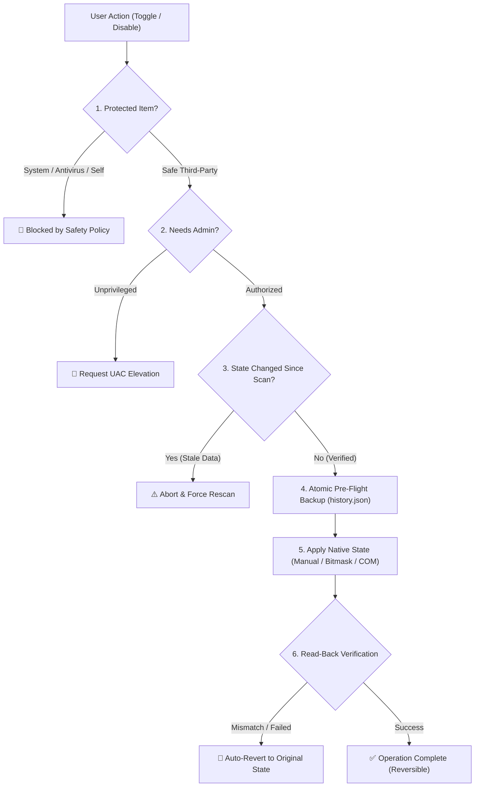

<div align="center">


# WinBGM

**Windows Background Manager**
<br/>
**The safe, modern background application & persistence manager for Windows 10 and 11.**

[](https://go.dev/)
[](https://wails.io/)
[](https://microsoft.com/windows)
[]()
[]()
[](https://virustotal.com)
[](LICENSE)

<br/>

[Why WinBGM?](#-why-winbgm) •
[Safety Engine](#-how-safe-is-it) •
[Key Capabilities](#-key-capabilities) •
[Persistence Vectors](#-12-persistence-locations) •
[Download & Build](#-quick-start)

</div>

---

## ⚡ Why WinBGM?

- **Windows Task Manager** only exposes basic startup folders and active tasks, hiding deep persistence vectors.
- **Sysinternals Autoruns** lists raw registry keys with zero guardrails—one accidental deletion can brick your OS.
- **WinBGM is the safe middle ground**: It scans **12 persistence vectors** (services, shell extensions, scheduled tasks, browser native hosts, WMI), groups them cleanly by application, and enforces an **ironclad, zero-deletion safety architecture**.

### Feature Comparison

| Capability                         |          Task Manager          |       Sysinternals Autoruns        |                    WinBGM                    |
| :--------------------------------- | :----------------------------: | :--------------------------------: | :------------------------------------------: |
| **Deep Persistence**               |     ⚠️ Basic Run keys only     |  ⚠️ 100+ raw entries (ungrouped)   |       **✅ 12 Vectors Grouped by App**       |
| **100% Reversible Changes**        |           ⚠️ Partial           | ❌ Deletes / renames registry keys |   **✅ Native Bitmasks (Zero Deletions)**    |
| **Audit Trail & 1-Click Rollback** |            ❌ None             |              ❌ None               |   **✅ Full JSON History & Instant Undo**    |
| **Critical OS / Antivirus Lock**   |            ❌ None             |    ❌ None (Can unboot system)     |     **✅ 8 Hard Kernel & AV Guardrails**     |
| **Live RAM Telemetry**             | ⚠️ Inflated across shared DLLs |        ❌ No live telemetry        | **✅ Deduplicated `psapi.dll` Working Sets** |
| **Boot Event Profiler**            |      Basic "Impact" label      |              ❌ None               |  **✅ Event IDs 100–109 Milisecond Audit**   |
| **Sleep Blocker Detection**        |            ❌ None             |              ❌ None               |    **✅ Real-time `powercfg /requests`**     |
| **VirusTotal Integration**         |            ❌ None             |           ⚠️ Hashes only           |   **✅ 1-Click SHA-256 Lookup Everywhere**   |
| **Baseline Snapshots & Diffing**   |            ❌ None             |         ⚠️ Text diff only          |    **✅ Visual State Diffs & Rollbacks**     |
| **Process Controls**               |        ⚠️ End Task only        |              ❌ None               |    **✅ Freeze, Resume, Close, End Task**    |
| **Modern Fluent UI**               |          Standard OS           |            Legacy Win32            |    **✅ Dark / Light / AMOLED + Accents**    |

---

## 🛡️ How Safe Is It?

WinBGM operates on a strict **zero-deletion, atomic verification** philosophy enforced directly in compiled Go backend code:

1. **Zero Deletions**: We never delete files or registry entries. Startup items use the native Windows `StartupApproved` bitmask; services are demoted to `Manual` (never `Disabled`); scheduled tasks use native COM toggles.
2. **Pre-Flight Snapshots**: Before any modification, original values are flushed to `%APPDATA%\WinBGM\history.json`. If disk write fails, the operation aborts.
3. **Live Re-Verification**: If a key changed externally since the last scan, changes are refused.
4. **Post-Write Auto-Restore**: If the system rejects a change or returns unexpected bytes, WinBGM reverts immediately.
5. **Critical System & AV Shield**: Core Windows processes, RPC/DCOM services, and installed security software (Defender, CrowdStrike, SentinelOne, etc.) cannot be modified.



---

## ✨ Key Capabilities

### 🔍 Deep Autostart Discovery

- **Aggregated App View**: Unifies background processes, autostart registry entries, scheduled tasks, and services into a single clean application card.
- **Explorer Shell Extensions**: Detects in-process DLL context menu handlers loaded directly into `explorer.exe`.
- **Browser Native Messaging**: Audits background IPC bridges registered by Chrome, Edge, Brave, and Firefox.
- **WMI & Winlogon**: Inspects stealth persistence (`root/subscription` event consumers and `Userinit` / `Shell` hooks).

### 🧪 1-Click VirusTotal & Security Audits

- **Instant SHA-256 Lookup**: One-click hash audit integrated across **Scheduled Tasks**, **Services**, **Startup Locations**, **Diff Views**, and **Action Modals**.
- **Impersonation Alerts**: Detects stealth binaries posing as Windows system files (e.g., non-System32 `svchost.exe` or `explorer.exe`).
- **Authenticode Signature Check**: Verifies digital certificates via `wintrust.dll`.

### ⏱️ Boot Profiler & Battery Sleep Blockers

- **Boot Breakdown (Event IDs 100–109)**: Millisecond analysis of **MainPathBootTime** (kernel to desktop) and **PostBootTime** (desktop to idle), pinpointing startup-degrading apps and drivers.
- **Sleep Blocker Inspector**: Queries `powercfg /requests` in real time to show which audio drivers or background processes keep your laptop awake.

### 📸 Baseline Snapshots & Differential Engine

- **Instant Snapshot**: Capture your PC's autostart footprint before installing new software.
- **Visual Diff**: Compare against any baseline to reveal stealth persistence, with 1-click rollbacks.

### ⏸️ Precision Process Controls

- **Freeze (Suspend)**: Temporarily pause resource hogs using `NtSuspendProcess` without losing unsaved application state.
- **Resume / Close / End**: Restore frozen apps, gracefully exit via `WM_CLOSE`, or force-terminate hung processes.
- **Precise RAM Metrics**: Deduplicated `psapi.dll` working set calculations for true background memory usage.

### 🎨 Fluent Design & Customization

- **4 Themes**: **Dark**, **Light**, **AMOLED** (pure `#000000` black for OLED), and **System Sync** (mirrors Windows setting).
- **6 Accent Colors**: Windows Blue, Cyber Emerald, Neon Purple, Sunset Amber, Rose Crimson, and Electric Cyan.
- **UI Scaling**: Scalable from 80% to 140% with hotkeys (<kbd>Ctrl</kbd> + <kbd>+</kbd> / <kbd>-</kbd> / <kbd>0</kbd>).
- **Command Palette**: Press <kbd>Ctrl</kbd> + <kbd>K</kbd> to search apps, tasks, and services instantly.

---

## ⌨️ Shortcuts

| Shortcut                                      | Action                           |
| :-------------------------------------------- | :------------------------------- |
| <kbd>Ctrl</kbd> + <kbd>K</kbd>                | Open Search & Command Palette    |
| <kbd>Ctrl</kbd> + <kbd>+</kbd> / <kbd>=</kbd> | Increase UI Scale (+10%)         |
| <kbd>Ctrl</kbd> + <kbd>-</kbd>                | Decrease UI Scale (-10%)         |
| <kbd>Ctrl</kbd> + <kbd>0</kbd>                | Reset UI Scale to Default (100%) |
| <kbd>Esc</kbd>                                | Close Modals & Slide-Over Panes  |

---

## 🚀 Quick Start

### Pre-Built Binaries

Download the standalone executable from [GitHub Releases](https://github.com/hariharen9/WinBGM/releases):

- **`WinBGM-windows-amd64.exe`** (Standard Intel/AMD 64-bit)
- **`WinBGM-windows-arm64.exe`** (ARM64 Windows on Snapdragon / Surface)
- **`WinBGM-windows-386.exe`** (Legacy 32-bit)

_Portable single binary. No installation required._

---

### Building from Source

```powershell
# 1. Install prerequisites: Go 1.23+ and Wails CLI
go install github.com/wailsapp/wails/v2/cmd/wails@latest

# 2. Clone repo & build production binary
git clone https://github.com/hariharen9/WinBGM.git
cd WinBGM
go mod tidy
wails build -clean -trimpath -ldflags "-s -w"
```

Output binary: `build\bin\WinBGM.exe`

---

## ⚖️ License

Distributed under the **MIT License**. See `LICENSE` for details.
